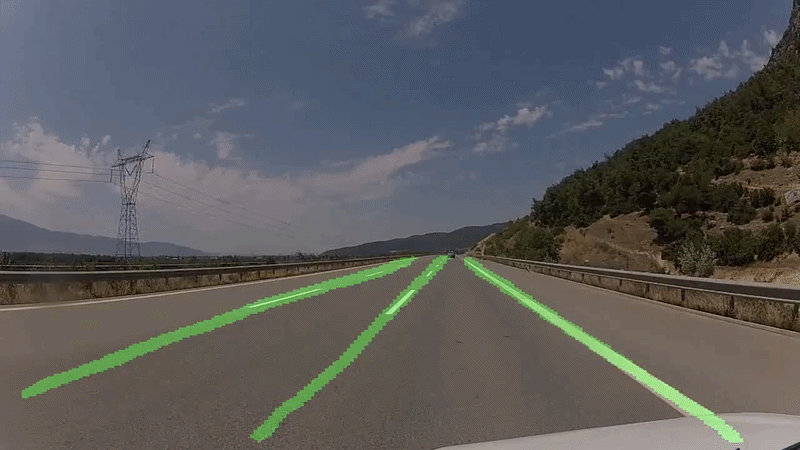

# Road Lane Segmentation

Streamlit app for generating road-lane masks and overlays from images and videos with a TensorFlow VGG16 U-Net model.




## Features

- Upload JPG, JPEG, or PNG images, take a camera photo, or process MP4, AVI, or MOV video.
- Compare masks and overlays, customize image overlay color, and download results.
- Preview processed videos with FFmpeg.

Inputs are resized to 224 x 224 and normalized to `[0, 1]`. Model predictions above `0.5` are classified as lane pixels. Video is processed frame by frame.

## Model storage

`models/best_model.keras` is stored with **Git LFS**. Git tracks a small pointer; Git LFS stores the 224 MB model file. `.gitattributes` configures LFS for this model. GitHub Free includes 10 GiB of LFS storage and 10 GiB of monthly download bandwidth; clones and Render builds use that bandwidth ([GitHub LFS quotas](https://docs.github.com/en/billing/concepts/product-billing/git-lfs)).

## Run locally

Install Git LFS, then from the project directory run:

```bash
git lfs install
git lfs pull
python -m venv .venv
source .venv/bin/activate
python -m pip install -r requirements.txt
streamlit run app.py
```

On Windows PowerShell, activate the environment with `.\.venv\Scripts\Activate.ps1` instead of `source .venv/bin/activate`.

## Deploy on Render

1. Create a Render **Blueprint** from this GitHub repository.
2. Deploy using [`render.yaml`](render.yaml). The build installs dependencies and checks the model. If Render checked out only the LFS pointer, `download_model.py` fetches the actual LFS object.

The Blueprint uses Render's Standard plan (1 CPU, 2 GB RAM); TensorFlow may exceed the free plan's 512 MB RAM. See [Render pricing](https://render.com/pricing). A fresh build may download the 224 MB model again, using GitHub LFS bandwidth.

## Project files

```text
app.py                 Streamlit interface
model.py               Loads the Keras model
download_model.py      Ensures the full LFS model is available during build
image_predict.py       Image preprocessing and prediction
video_predict.py       Frame-by-frame video processing
render.yaml            Render Blueprint configuration
notebook/              TuSimple training notebook
requirements.txt       Python dependencies
```

The training notebook uses Kaggle TuSimple paths; the dataset is not included.
