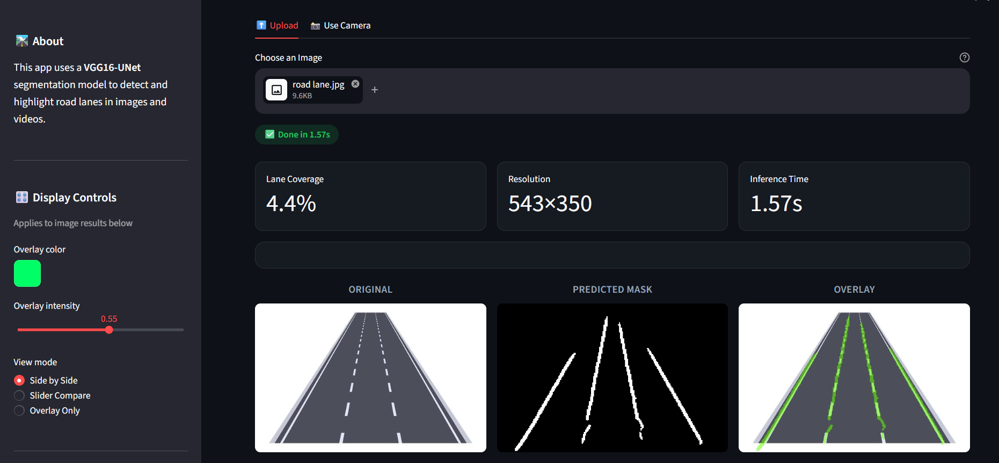

# Road Lane Segmentation

A Streamlit application for predicting road-lane masks in still images and videos. It uses a TensorFlow/Keras VGG16 U-Net model, displays the predicted mask and an image overlay, and provides downloads for the results.




## What the app does

- Predicts a binary lane mask from JPG, JPEG, or PNG images.
- Accepts a photo from the in-app camera.
- Processes MP4, AVI, and MOV videos frame by frame.
- Shows image results side by side, as an overlay, or in a before/after slider.
- Lets you adjust the image overlay color and intensity.
- Reports image lane coverage, input resolution, and inference time.
- Provides downloads for the mask, image overlay, and processed video.
- Uses FFmpeg, if available, to create a browser-friendly H.264 video preview.

## How prediction works

The image and video pipelines use the same basic process:

1. Read the source image or video frame and convert it to RGB.
2. Resize it to **224 x 224** and normalize channel values to `[0, 1]`.
3. Run the saved model to obtain a one-channel sigmoid prediction.
4. Classify values greater than `0.5` as lane pixels.
5. Resize the binary mask back to the source dimensions with nearest-neighbor interpolation.
6. Blend a green mask with the original image to make an overlay.

The training notebook defines a U-Net-style decoder with skip connections and a VGG16 encoder initialized with ImageNet weights. It uses Dice loss and the Adam optimizer. The app loads a saved checkpoint; it does not train the model at startup.

### Model details

- **Input shape:** one RGB image, `1 x 224 x 224 x 3`.
- **Input values:** floating point values from 0 to 1.
- **Encoder:** VGG16 without its classification head, using ImageNet initialization in the notebook.
- **Decoder:** upsampling blocks concatenate encoder features at matching resolutions and produce one sigmoid output channel.
- **Mask threshold:** `0.5`, configured in `image_predict.py`.
- **Inference overlay:** `image_predict.py` blends the source image at 70% with a green mask at 30%. The Streamlit image display has separate color and intensity controls.

This project demonstrates segmentation inference. It does not track lane boundaries over time or implement a driving system. The repository does not include benchmark metrics or guarantee performance across road, weather, camera, or lighting conditions.

## Requirements

- Python and the packages listed in [`requirements.txt`](requirements.txt)
- A trained Keras model at `models/best_model.keras`
- FFmpeg is optional; without it, video processing still runs, but browser playback compatibility may vary.

The trained model is present in this project workspace, but `.gitignore` excludes it from Git. A fresh clone therefore needs its own copy of `models/best_model.keras` (about 214 MiB / 224 MB). The project does not provide a hosted model download.

## Installation and launch

Run these commands from the project directory. In Windows PowerShell:

```powershell
python -m venv .venv
.\.venv\Scripts\Activate.ps1
python -m pip install -r requirements.txt
streamlit run app.py
```

On macOS or Linux, create the environment with `python -m venv .venv`, activate it with `source .venv/bin/activate`, then install requirements and run `streamlit run app.py`.

The app creates `uploads/` and `outputs/` when it starts. Open the local address printed by Streamlit in your browser. Run Streamlit from the project directory because the model and working folders are referenced with relative paths.

TensorFlow requires a compatible Python and platform combination. If installation fails, create an environment compatible with the TensorFlow version pinned in `requirements.txt` and retry the installation.

## Using the app

### Image mode

Upload a JPG, JPEG, or PNG file, or use the camera input. When prediction finishes, the page reports:

- **Lane coverage:** percentage of pixels classified as lane in the resized-to-original binary mask.
- **Resolution:** width and height of the original image.
- **Inference time:** elapsed time for the image prediction call.

Choose an image view in the sidebar:

- **Side by Side** shows the original, binary mask, and overlay in separate columns.
- **Slider Compare** lets you drag a control to reveal the original or overlay.
- **Overlay Only** displays the blended result.

The sidebar color picker and intensity slider customize the displayed overlay. Use the download buttons to save the PNG overlay and PNG mask. The raw mask is also available in the page expander. Select **Start Over** to clear the current image result and process another image.

### Video mode

Upload an MP4, AVI, or MOV file. The app processes frames sequentially and displays a progress bar while it runs. The preview has autoplay, loop, and muted controls, and the completed video can be downloaded. Processing time depends on the video length, frame size, and available hardware because the model runs once per frame.

Video overlay styling is fixed by the inference helper; the image sidebar color controls apply to image results. If FFmpeg is installed, the app attempts an H.264 conversion for preview. If conversion is unavailable or fails, the preview uses the OpenCV output.

## Generated files

- Uploaded inputs are written to `uploads/` using the uploaded filename.
- `image_predict.py` writes `outputs/predicted_mask.png` and `outputs/overlay.png`. Those filenames are reused for subsequent standalone image predictions.
- The Streamlit video workflow writes `outputs/lane_output.mp4` using OpenCV's `mp4v` codec.
- When FFmpeg is available and conversion succeeds, `outputs/lane_output_web.mp4` is also created for browser preview. The download button serves the OpenCV-produced MP4.
- The Streamlit page also exposes downloads directly, so you do not need to browse the output folder.

`uploads/` and `outputs/` contain inputs and generated results; they are runtime folders, not source code.

## Run the image script directly

The helper script can also be run without the Streamlit interface. Place an image at `uploads/test.jpg`, then run:

```bash
python image_predict.py
```

It writes `outputs/predicted_mask.png` and `outputs/overlay.png`. The script loads the model from `models/best_model.keras`, just like the app.

## Project structure

```text
.
|-- app.py                                  # Streamlit interface
|-- image_predict.py                        # Image preprocessing and prediction
|-- video_predict.py                        # Frame-by-frame video processing
|-- model.py                                # Model loading and Dice functions
|-- models/
|   `-- best_model.keras                    # Required trained model (not tracked)
|-- notebook/
|   `-- road-lane-segmentation-vggunet-tusimple.ipynb
|-- uploads/                                # Uploaded inputs (created at runtime)
|-- outputs/                                # Generated results (created at runtime)
`-- requirements.txt
```

## Training notebook and data

The notebook documents development using TuSimple data. Its cells expect a Kaggle dataset under `/kaggle/input/datasets/manideep1108/tusimple/`, including training clips and JSON label files. Preprocessing selects frames, creates image and mask files, and prepares 224 x 224 datasets. The notebook then defines and trains the network and saves a best model checkpoint.

The dataset and processed training folders are not included in this repository. The notebook uses Kaggle-specific paths, so update them before running it elsewhere. Keep image and mask filenames aligned. Copy the trained checkpoint to `models/best_model.keras` for the app to use.

## Troubleshooting

| Problem | Check |
| --- | --- |
| App reports a missing model file | Confirm `models/best_model.keras` exists and launch Streamlit from the project directory. |
| The model fails to load | Install dependencies from `requirements.txt` in a clean, compatible Python environment. The saved model must be compatible with the installed TensorFlow/Keras versions. |
| Video preview is blank or unsupported | Install FFmpeg and restart the app so it can attempt H.264 conversion. The OpenCV-processed MP4 is still produced for download. |
| An uploaded video cannot be opened | Confirm the file is a valid MP4, AVI, or MOV readable by the installed OpenCV build. |
| Image prediction fails | Confirm the file is a valid JPG, JPEG, or PNG and that the model loads successfully. |

